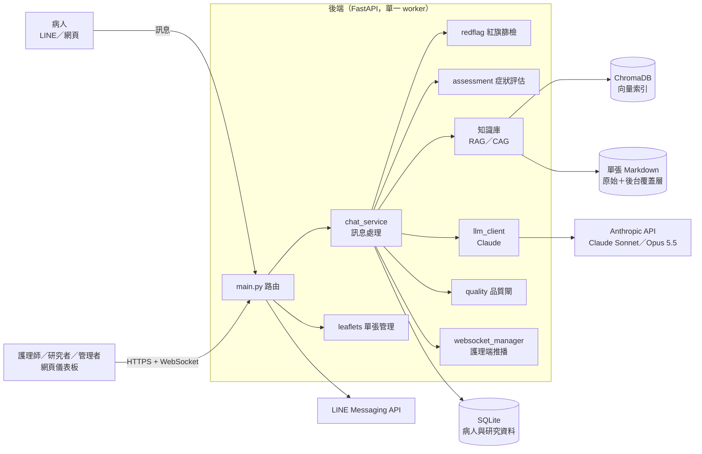
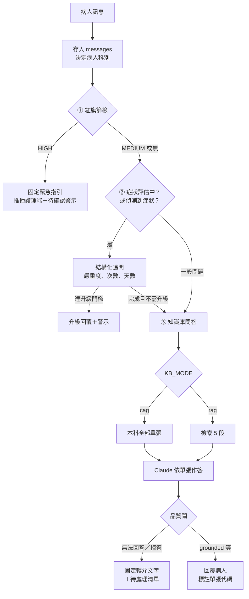

# AI 腫瘤衛教機器人　系統架構書 v3.0

> [!info] 文件狀態
> 現行版本，對應 `main` 分支 2026-11-27 的程式（資料庫 schema v7）。
> 取代 [[v1.0 系統架構書]]（Gemma、舊索引）與 [[v2.0 LINE整合版架構書]]（舊的 LINE 綁定方式）。
> 細節文件見各章末的「延伸閱讀」。

> [!danger] 目前不可用於真實病人
> 紅旗詞庫尚未經臨床人員審核，也還沒用獨立撰寫的測試集驗證。見 [[#13. 上線前待辦]]。

**一句話**：化學治療病人用 LINE（或網頁）問衛教問題，系統先篩檢緊急症狀，再依院內 13 份衛教單張回答並標註出處；
護理端即時收到警示，研究端可匯出去識別化資料。

---

## 1. 系統概覽

### 1.1 使用者與入口

| 角色 | 入口 | 能做的事 |
|---|---|---|
| 病人 | LINE 官方帳號（主要）、網頁聊天室 | 問衛教問題、症狀評估、知識測驗 |
| 護理師／研究者（researcher） | 網頁儀表板 | 看對話與時間軸、即時警示與確認、症狀統計、匯出去識別化 CSV |
| 管理者（admin） | 網頁儀表板 | 以上全部，加上建立病人、發 LINE 通行碼、**單張管理**、人員稽核 |

### 1.2 設計原則

1. **安全先於回答**：每則訊息先經紅旗篩檢（不經 LLM、確定性規則），急症直接回固定的緊急指引並通知護理端。
2. **只依據院內單張**：模型只能用提供的單張內容回答、必須標註單張代碼；資料沒有就輸出「無法回答」標記，由系統改成固定轉介文字。
3. **單張內容不改寫**：知識庫以院內核可版本為準；系統只做格式轉換，後台上傳時比對原文。
4. **去識別化**：病人在系統內只用假名代號（P001），真名不進 LLM、不進研究匯出。
5. **不做系統做不到的承諾**：轉介文字不說「護理師會盡快回覆」，緊急狀況一律指引撥打 119 或科別電話。
6. **擴充不改程式**：新增科別、更新單張都只動設定檔或後台，不需要改程式。

### 1.3 系統邊界

- 系統提供**衛教**，不做診斷、不建議調整藥物劑量。
- 不取代護理師：警示需要人確認，值班流程見 `docs/ops/警示處理SOP_草案.md`。
- 知識範圍只有本科衛教單張；範圍外問題一律轉介。

---

## 2. 整體架構

| 層 | 技術 | 說明 |
|---|---|---|
| 病人介面 | LINE Messaging API（Quick Reply 按鈕）、`frontend/index.html` | 網頁版也供測試與演示 |
| 護理／管理介面 | `frontend/index.html`（同一頁依角色顯示） | WebSocket 即時警示、提示音、斷線重連 |
| API | FastAPI + uvicorn，**單一 worker** | 護理端連線清單與 LINE 事件去重都在同一行程 |
| 知識庫 | Markdown 單張 → ChromaDB（cosine），嵌入用 ONNX | 不需要 torch |
| LLM | Anthropic Claude Sonnet 5.5（建議）或 Opus 5.5 | 演示模式 `mock` 不需 API key |
| 資料庫 | SQLite（WAL） | 身分與研究資料分表 |
| 部署 | Docker Compose + Caddy（自動 HTTPS） | 另有 AWS EC2 與 Cloudflare 測試部署 |

---

## 3. 一則病人訊息的處理流程

`chat_service.process_message`（網頁與 LINE 共用）：

1. **紅旗**（`redflag.py`，不經 LLM）：HIGH 直接回固定緊急指引、通知護理端、建立待確認警示，不再往下走。MEDIUM 記錄並通知（非緊急），繼續往下。
2. **症狀評估**（`assessment.py`）：偵測到症狀（噁心、腹瀉、口腔黏膜炎等 10 種協定）時，用按鈕追問嚴重度（ESAS 0–10）、次數或天數；達門檻升級為 MEDIUM／HIGH。完成後接著提供該症狀單張的衛教。「預防性或一般資訊問題」不會被攔進評估。
3. **知識庫問答**：見第 5、6 章。
4. **品質閘**（`quality.py`）：回答後標記品質，無法回答或拒答時改回固定轉介文字，並把問題放進護理端待處理清單（info 等級，不推播）。

---

## 4. 模組說明（`backend/`）

| 模組 | 職責 |
|---|---|
| `main.py` | 只放路由；身分一律經 `security.py` 取得 |
| `chat_service.py` | 訊息處理流程（第 3 章）、警示通知、落庫 |
| `redflag.py` | 紅旗：通用核心規則＋科別擴充，關鍵字為底、向量補充（第 7.1 節） |
| `safety_text.py` | 病人端安全文字（緊急指引、轉介、說明）的單一來源 |
| `assessment.py` | 症狀結構化評估協定（依科別 manifest） |
| `departments.py` | 科別註冊表：讀 `knowledge/<科別>/manifest.json`，設定錯誤啟動即失敗 |
| `embedding.py` | 嵌入模型註冊表與 ONNX 推論（檢索 e5-small、紅旗 MiniLM） |
| `rag.py` | 向量檢索（依科別），索引模型不一致時拒絕檢索 |
| `kb.py` | CAG：本科全部單張；`KB_MODE` 判斷 |
| `prompt.py` | System prompt：安全規則、語氣、單張內容、回答規則 |
| `llm_client.py` | Claude（及 Gemma、mock）呼叫、快取、拒答重試 |
| `quality.py` | 品質標籤與引用核對 |
| `leaflets.py` | 單張管理後台：轉換、預覽、上架、停用、退回、同步索引 |
| `auth.py`、`security.py` | 帳密、token、登入鎖定、WebSocket 票券、角色權限 |
| `binding.py`、`line_bot.py` | LINE 通行碼綁定、webhook、Quick Reply |
| `websocket_manager.py` | 護理端即時推播 |
| `db.py` | SQLite schema 與遷移（v7） |
| `stats.py`、`activity.py` | 世代統計、去識別化匯出、時間軸與人員稽核 |
| `quiz.py` | 衛教知識測驗（前後測） |
| `alert.py` | **舊版**關鍵字模組，已由 `redflag.py` 取代，沒有程式引用 |

`scripts/`：`index_vault.py`（建立／同步索引）、`eval_retrieval.py`（檢索評估）、`live_llm_eval.py`（Claude 實測）、
`build_pages.py`（匯出演示資料）、`seed_demo.py`、`demo_dry_run.py`。

---

## 5. 知識庫

### 5.1 單張與科別

- 單張是 Markdown，frontmatter 必填 `code`、`category`、`doc_version`、`rag_index`；章節用 `## 標題`。
  「參考資料」「護理指導評值」不進知識庫。
- 血液腫瘤科 13 份單張（ONC-17～ONC-40），全文約 1.6 萬字，放在 `Obsidian_Vault/衛教知識庫/`。
- 每個科別一份 `knowledge/<科別>/manifest.json`：單張來源、緊急電話、紅旗擴充、急症回覆覆寫、症狀評估協定。
  病人綁定科別，檢索、紅旗、評估、緊急電話都依科別。新增科別見 `docs/knowledge/新增科別說明.md`。

### 5.2 單張更新

| 方式 | 適用 | 生效 |
|---|---|---|
| **單張管理後台**（管理者網頁） | 院內改版、新增、停用 | 上架即時生效 |
| 直接改 repo 單張 | 開發與整批匯入 | 執行 `index_vault.py` 或重新部署 |

後台上傳 Word／Markdown／PDF → 轉換預覽（章節、段落、與原檔文字的差異）→ 上架。PDF 必須勾選「已逐段核對」。
上架版本寫在 `data/leaflets/<科別>/<代碼>.md`（覆蓋層，同代碼優先於原始單張），版本紀錄在 `leaflet_versions`，
可退回任一舊版或院內原始版。每則回答記錄所依據的單張版本（`messages.rag_doc_versions`）。

### 5.3 交給模型的方式：RAG、CAG 與 auto

| 模式 | 做法 | 適用 |
|---|---|---|
| `rag` | 每題檢索最相關的 5 段（嵌入模型 multilingual-e5-small，段落 ≤ 256 token） | 單張很多的科別 |
| `cag` | 本科全部單張放進 system prompt 的固定前段，由 Claude **prompt caching** 快取 | 單張少的科別 |
| **`auto`（預設）** | LLM 是 Claude 且本科單張 ≤ 60,000 字用 CAG，否則 RAG；演示模式一律 RAG | 混合架構 |

CAG 的 system prompt 分兩段：**固定前段**（安全規則＋全部單張＋回答規則，跨病人相同、快取 1 小時）與
**變動後段**（語氣、病患資訊、輸出格式）。後台上架單張時快取立即失效重載。

實測（Sonnet 5.5，99 題）：CAG 範圍內依據單張作答 75/79（RAG 67/79），上次因檢索失誤答錯的 7 題全部改善；
兩者都沒有編造內容。依據見 `docs/knowledge/RAG與CAG比較.md`、`docs/knowledge/檢索評估.md`。

---

## 6. LLM 層

### 6.1 模型與設定

| 設定 | 值 | 說明 |
|---|---|---|
| `LLM_PROVIDER` | `anthropic`（正式）／`mock`（演示）／`google`（不可用於真實病人） | |
| `PRIMARY_MODEL` | `claude-sonnet-5-5`（建議）或 `claude-opus-5-5` | Sonnet 更貼近單張原文、費用約 Opus 的 41%（`docs/knowledge/Claude實測結果.md`） |
| `LLM_EFFORT` | `low` | 這兩個模型不接受 temperature，以 effort 控制 |
| `ANTHROPIC_REFUSAL_FALLBACK` | `false` | 研究收案只用單一模型；設 `true` 時拒答改由 API 的備援模型回答 |
| `ANTHROPIC_INFERENCE_GEO` | `us` | 只在美國境內運算（價格 1.1 倍）；金鑰建在 Workspace geo = US 的工作區 |
| `CACHE_TTL` | `1h` | CAG 快取保存時間 |

### 6.2 Prompt 組成（`prompt.py`）

1. **安全規則**（永遠在最前面）：緊急症狀立即給緊急指引、不給劑量建議、不診斷。
2. **語氣**：`simple`（65 歲以上自動使用）、`general`、`detailed`。
3. **病患資訊**：年齡、診斷、用藥（**不含真名**）。
4. **單張內容**：RAG 的 5 段，或 CAG 的全部單張。
5. **回答規則**：只用提供的資料、每項建議標註單張代碼、資料沒有就只輸出 `[無法回答]`、
   **不得改寫數值與修飾詞**、可執行的建議必須取自資料。

### 6.3 品質標籤（`quality.py`）

| 標籤 | 意義 | 病人看到 |
|---|---|---|
| `grounded` | 引用的代碼都在提供的資料內 | 模型回答 |
| `uncited` | 沒有標註任何代碼 | 模型回答（研究資料標記） |
| `citation_mismatch` | 標註了沒提供的代碼 | 模型回答（研究資料標記） |
| `safety_escalation` | 只給緊急指引（119／1925） | 模型回答 |
| `deflected_unanswerable` | 模型輸出無法回答標記 | 固定轉介文字 |
| `deflected_off_source` | 模型自述無法回答且沒有引用 | 模型回答 |
| `deflected_no_source` | 沒有可用的單張 | 固定轉介文字 |
| `llm_refusal` | 模型拒答（重試後仍拒答） | 固定轉介文字 |
| `redflag_shortcut`、`assessment*` | 紅旗或評估路徑，未經 LLM | 固定文字 |

### 6.4 拒答處理

Claude 的安全分類器偶爾誤判。研究收案預設 `ANTHROPIC_REFUSAL_FALLBACK=false`：拒答時**同模型重試一次**，仍拒答回固定轉介文字，全部回覆出自同一個模型。
設為 `true` 時的處理順序：API 的 server-side fallback（`fallbacks: "default"`）→
若沒接手，有 `recommended_model` 就照建議重試，否則**同模型重試一次** → 仍拒答才回固定轉介文字。
拒答類別記在 `messages.refusal_category`，收案時統計拒答率。

---

## 7. 安全設計

### 7.1 紅旗（`redflag.py`）

- **兩層規則**：通用核心（胸痛、呼吸困難、意識改變、出血、脫水、過敏、外傷、自傷，所有科別適用）＋
  科別擴充（manifest：發燒等級、體溫門檻、額外關鍵字）。血液腫瘤科：發燒為 HIGH，38.0°C 以上 HIGH、37.5°C 以上 MEDIUM。
- **判斷方式**：關鍵字為底（含台語與口語、正規表示式），否定詞只在同一子句內生效（「沒有胸痛」不觸發）；
  未命中 HIGH 時用向量補充（MiniLM，相似度 ≥ 0.85；門檻在此模型上校準，不跟著檢索模型換）。
- **回歸測試集**：`backend/redflag_cases.json` 共 80 題，後端與演示引擎共用。
- 病人端安全文字只來自 `safety_text.py`；自傷回覆附 1925 安心專線，且不可被科別覆寫。

### 7.2 警示與值班

- 警示等級：HIGH（推播＋提示音）、MEDIUM（推播）、info（範圍外問題，只進清單）。
- 護理端未確認清單、確認（ack）紀錄；推播據實記錄是否送達。
- 確認時限設定：`ALERT_SLA_HIGH_MIN`（15 分）、`ALERT_SLA_MEDIUM_MIN`（240 分）、`ALERT_SLA_INFO_MIN`（1,440 分）。

### 7.3 身分與存取

| 機制 | 設定 |
|---|---|
| 登入 token | HMAC 簽章，12 小時有效；`AUTH_SECRET` 正式環境必填 |
| 登入失敗鎖定 | 5 次失敗鎖 15 分鐘 |
| 護理端 WebSocket | 先換短效票券（60 秒），網址不帶長效 token |
| LINE 綁定 | 管理者發一次性通行碼（72 小時有效、只存雜湊），病人在 LINE 輸入完成綁定；失敗次數限制 |
| LINE webhook | 驗證 `X-Line-Signature`（HMAC-SHA256）、事件去重 |
| 角色 | patient／researcher／admin，依路由檢查 |

### 7.4 資料隱私

- 身分與研究資料分表；病人以假名代號識別，平台不收真名（對照表由研究團隊另行保管）。
- 送進 LLM 的只有假名資料（當次提問、最近 12 則對話、單張內容、年齡、診斷、說明深度），每個請求帶 `inference_geo=us`，只在美國境內運算；
  Anthropic 依商業條款不以 API 資料訓練模型，API 輸入輸出 30 日內刪除（違反使用政策者至多 2 年）。
- 主機硬碟加密；AWS 每日加密快照（`deploy/aws/enable_backup.sh`），其他主機用 `deploy/backup.sh` 產生 AES-256 加密備份檔。
- 研究匯出前遮蔽病人自行輸入的個資（手機與市話、身分證號、email、LINE ID、可能是病歷號的長串數字）。
- 研究者查看病人資料都記入稽核（`events.actor`）。
- 含病人資料的檔案（`.env`、`data/*.sqlite3`、`chroma_db/`、`models/`）絕不進版控。

---

## 8. 資料庫（SQLite，schema v7）

| 表 | 內容 |
|---|---|
| `users` | 帳號、角色、密碼雜湊、登入失敗次數 |
| `patients` | 假名代號、年齡、性別、癌別、教育程度、**科別** |
| `sessions` | 對話階段 |
| `messages` | 每則訊息：紅旗等級、引用來源、模型、token、**品質標籤**、**單張版本**、**快取用量**、**拒答類別** |
| `alerts` | 警示：等級、觸發原因、通知管道、確認者與時間 |
| `symptom_scores`、`assessment_state` | 症狀評估分數與進行中的評估 |
| `comprehension_checks`、`quiz_results` | 了解程度與知識測驗 |
| `events` | 稽核紀錄（誰、何時、做了什麼） |
| `binding_codes`、`line_bindings`、`line_events_seen` | LINE 綁定與事件去重 |
| `leaflet_versions` | 單張管理後台的版本紀錄 |

遷移在啟動時自動執行（`db.init_db`），舊資料庫直接升級。

---

## 9. API 端點

| 類別 | 端點 | 權限 |
|---|---|---|
| 認證 | `POST /login`、`POST /ws/ticket`、`WS /ws/nurse` | — ／ staff |
| 病人 | `POST /chat`、`GET /quiz/topics`、`GET/POST /quiz/{code}` | patient |
| LINE | `POST /line/webhook` | LINE 簽章 |
| 護理／研究 | `GET /sessions`、`GET /history/{code}`、`GET /alerts`、`POST /alerts/{id}/ack`、`GET /logs/patient/{code}`、`GET /stats/*`、`GET /export/{table}.csv`、`GET /departments` | researcher、admin |
| 管理：病人 | `GET/POST /admin/patients`、`POST /admin/patients/{code}/binding-code`、`DELETE /admin/patients/{code}/binding`、`GET /logs/staff` | admin |
| 管理：單張 | `GET /admin/leaflets`、`GET /admin/leaflets/{dept}/{code}/versions`、`POST/GET/PUT/DELETE /admin/leaflets/drafts[/{id}]`、`POST …/publish`、`POST /admin/leaflets/{dept}/{code}/retire｜restore`、`GET /admin/leaflets/versions/{id}/original` | admin |
| 系統 | `GET /health` | — |

---

## 10. 部署

| 方式 | 用途 | 文件 |
|---|---|---|
| Docker Compose + Caddy（自動 HTTPS） | 正式部署的標準做法，任何 Linux 主機 | `docs/deploy/部署說明.md` |
| AWS EC2 台北（ap-east-2） | 建議的雲端主機，資料留在台灣；CloudShell 一鍵建立 | `docs/deploy/AWS部署步驟.md` |
| Cloudflare Containers | **只供測試**（硬碟暫時，休眠後資料清空），網站密碼保護 | `docs/deploy/Cloudflare測試部署.md` |
| 本機演示 | `LLM_PROVIDER=mock`，不需 API key | `docs/demo/演示腳本.md` |

- 規格：2 vCPU、4 GB 記憶體、20 GB 以上硬碟；執行時約 1 GB 記憶體（兩個嵌入模型）。
- 映像不含病人資料、密鑰或模型；容器每次啟動自動同步單張索引。
- 主要設定（`.env`）：`AUTH_SECRET`、`LLM_PROVIDER`、`PRIMARY_MODEL`、`ANTHROPIC_API_KEY`、`KB_MODE`、
  `LINE_CHANNEL_SECRET`／`LINE_CHANNEL_ACCESS_TOKEN`、`EMERGENCY_CONTACT`、`DOMAIN`。

---

## 11. 測試與評估

| 類別 | 內容 |
|---|---|
| 後端自動測試（不需 API key） | 16 支：phase1–3、quiz、integration、redflag（94）、alerts、llm_claude、kb_update、departments、leaflets（60）、cag（50）、binding、logs、security、retrieval |
| 演示 | 演示引擎 34 項、`demo_dry_run.py` 彩排 24 項 |
| 檢索評估 | `scripts/eval_retrieval.py`：79 題口語問題；e5-small Hit@1 0.82（MiniLM 0.66） |
| Claude 實測 | `scripts/live_llm_eval.py`：99 題（範圍內 79、範圍外 15、邊界 5）＋ Opus 評審 |

主要實測結果（開發者撰寫的題目，**不是臨床驗證集**）：

| 指標 | 結果 |
|---|---|
| 編造單張沒有的醫療內容 | 0 題（Sonnet、Opus、RAG、CAG 都是） |
| 範圍外問題正確轉介 | 15/15 |
| CAG 依據單張作答 | 75/79 |
| 「低蛋白」改寫錯誤 | 修正後 4 → 0 |

---

## 12. 費用估計

| 項目 | 估計 |
|---|---|
| Claude Sonnet 5.5（CAG、快取有效） | 每題約 US$0.008（約台幣 0.25 元）；只在美國運算再乘 1.1 |
| 快取失效時 | 該題約 US$0.08（1 小時快取寫入一次） |
| 收案 100 人 × 每人 50 題 | 約 US$40–60（依快取命中率） |
| AWS EC2 台北 t3.medium | 每月約 US$45–50 |
| Cloudflare 測試 | 每月 US$5 起 |

上線後用 `messages` 的快取欄位每週計算命中率與實際費用；CAG 太貴時可改回 `KB_MODE=rag`。

---

## 13. 上線前待辦

| 項目 | 負責 | 狀態 |
|---|---|---|
| 紅旗詞庫臨床審核、以獨立測試集驗證 | 臨床人員 | **必要，未完成** |
| ONC-22「低纖維、蛋白」措辭是否易誤讀 | 護理團隊 | 待確認 |
| ONC-25「外出戴口罩」只在評值題、內文沒有 | 護理團隊 | 待確認 |
| 皮膚出血點應分流到 119 或回診 | 護理團隊 | 待確認 |
| 保健食品、偏方類問題的固定回覆 | 研究與護理團隊 | 待確認 |
| 緊急電話是否 24 小時有人接聽 | 醫院 | 待確認 |
| 值班 SOP 與警示確認時限 | 護理團隊 | 草案（`docs/ops/`） |
| 正式主機與資料存放位置（院內或雲端） | 醫院資訊室 | 待確認 |
| 真實院內 Word／PDF 單張的轉換品質 | 管理者 | 待試用 |

---

## 14. 版本沿革

| 版本 | 時間 | 主要內容 |
|---|---|---|
| v1.0 | 2026-04 | 網頁聊天、Gemma 3 12B、MiniLM 檢索、關鍵字警示 |
| v2.0 | 2026-04 | LINE 整合規劃（綁定方式已被取代） |
| **v3.0** | 2026-11 | 紅旗 v2（核心＋科別、否定詞、向量補充）、警示確認、Claude Sonnet／Opus 5.5、只依單張作答與引用核對、LINE 通行碼綁定與按鈕、多科別、單張管理後台、檢索改用 e5-small、RAG／CAG／auto、Docker／AWS／Cloudflare 部署 |

### 延伸閱讀

- 專案說明：`README.md`
- 知識庫：`docs/knowledge/`（新增科別、單張管理後台、檢索評估、Claude 實測、RAG 與 CAG 比較）
- 部署：`docs/deploy/`
- 值班：`docs/ops/警示處理SOP_草案.md`
- 演示：`docs/demo/演示腳本.md`
- 設計規格：`docs/specs/`
